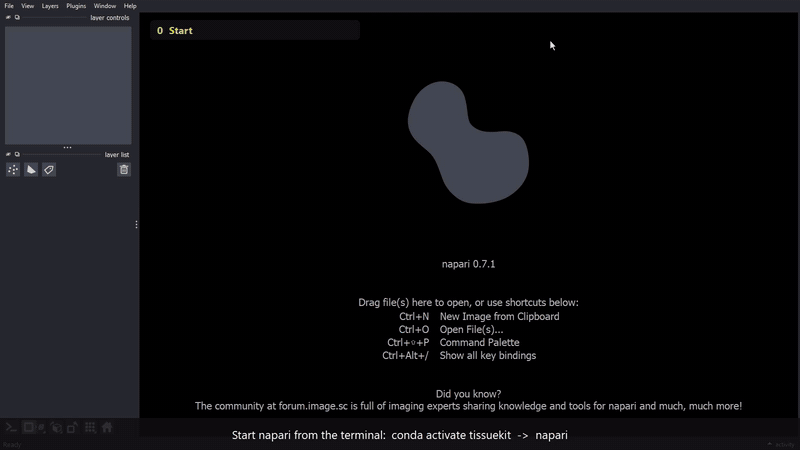

# napari-tissuekit

Segment cells in a time-lapse movie (Cellpose), track them over time, detect T1 neighbour
exchanges and export per-cell measurements. Use it as a **napari plugin** (point and click) or
as the **`tissuekit` command line** (for the HPC). Both use the same code and write the same
results folder.

## 1. Install

You need [Miniconda](https://docs.conda.io/en/latest/miniconda.html) (or Anaconda) and git.
The steps are the same on Windows 11 and macOS; only the terminal differs:

- **Windows 11:** open *Anaconda Prompt* (or *Miniconda Prompt*) from the Start menu.
- **macOS:** open *Terminal*.

```bash
git clone <URL of this repository>
cd Mesoderm-T1-tracking

conda create -n tissuekit python=3.10 -y
conda activate tissuekit

pip install -e "plugins/napari_tissuekit[gui]"
```

This installs the plugin, napari, Qt, Cellpose 4 and PyTorch. It takes a few minutes and
downloads a few GB. (`pip install -r requirements.txt` installs the same packages.)

Check that it worked:

```bash
tissuekit --help
```

Notes:
- Segmentation runs on the CPU by default (about a minute for the test movie). On a Windows PC
  with an NVIDIA GPU, install a CUDA build of PyTorch first (see pytorch.org) and tick
  *Use GPU* in the Segmentation tab. On Apple Silicon Macs the CPU is used.
- The first segmentation downloads the Cellpose `cpsam` model once (needs internet).
- On a headless HPC node, install without the viewer: `pip install -e plugins/napari_tissuekit`.

## 2. Open the GUI

Every time you want to work, open the terminal from step 1 and run:

```bash
conda activate tissuekit
napari
```

A napari window opens. In its menu choose **Plugins > TissueKit**. The TissueKit panel
appears on the right with four tabs: *Segmentation*, *Tracking*, *T1*, *Export Cell Props*.

Open your movie with **File > Open File(s)...** (or drag the `.tif` into the window).
If napari asks which reader to use, pick **napari builtins**.

Alternative, straight from Python:

```bash
python -c "import napari; v = napari.Viewer(); v.window.add_plugin_dock_widget('napari-tissuekit'); napari.run()"
```

## 3. Try it with the test data

`tests/data/movie_cut.tif` is a small crop (11 frames, 291 x 291 px) of a blastoderm movie.

Results are saved automatically in a folder **next to the movie**, called
`<movie name>_results`. To keep the repository clean, first copy the movie somewhere else,
for example to your Desktop, and open that copy.

A short walkthrough of the steps below (load, segment, track, select cells, colour by feature):



1. **Open the movie** (File > Open File(s)...), then **Plugins > TissueKit**.
2. **Segmentation** tab: *Image* = `movie_cut`, press **Run segmentation**.
   The status line at the bottom shows progress. When done, the layers `Segmentation` and
   `Outlines` appear. Leave the other settings as they are.
3. **Tracking** tab: *Labels* = `Segmentation`, *Intensity* = `movie_cut`
   (tracking is more accurate with the intensity image), press **Run tracking**.
   Cells keep one colour/ID over time in the `Tracked` and `Tracked RGB` layers. Use the
   time slider at the bottom of the viewer to step through frames.
4. **T1** tab: *Labels* = `Tracked`, *RGB* = `Tracked RGB`, press **Run T1**.
   `T1 overlay` and `T1 four-ways` show the detected events; the *T1 filter* box narrows them.
5. **Export Cell Props** tab: *Tracked labels* = `Tracked`, tick **Select cells**, click cells
   in the viewer, tick the features you want and press **Export CSV...**. The *Color* button
   next to a feature paints the selected cells by that value.

Everything lands in `<movie>_results/`:

```
movie_cut_results/
  segmentation/   masks + outlines (.tif)
  tracking/       tracked labels, tracked RGB, tracks / links / events (.csv), qc.json
  t1/             t1_events.csv
  cell_props/     exported measurements and cell selections
  settings.json   parameters of each step
```

### Skip the computing: load ready-made results

The folder `tests/data/` already holds finished results for the test movie.

1. Open `tests/data/movie_cut.tif` in napari, then **Plugins > TissueKit**.
2. Press **Folder...** and choose `tests/data`, then **Load results**
   (the *Folder...* button loads them straight away).
3. The `Segmentation`, `Tracked` and `Tracked RGB` layers appear. Continue with step 4 or 5 above.

**Load results** works the same way for any `<movie>_results` folder, also one copied back from
the HPC.

## 4. Command line (laptop or HPC)

```bash
tissuekit segment movie.tif [--preset cellflow] [--force-cpu]   # -> movie_results/segmentation/
tissuekit track   movie.tif                                     # -> movie_results/tracking/
tissuekit t1      movie.tif                                     # -> movie_results/t1/
```

On the HPC, `t1` needs a Slurm job (or `ALLOW_LOGIN_NODE=1`). Copy `<movie>_results/` back
and open it in napari with **Folder...**. Slurm helpers are in `hpc/`.
More options per step: `python -m napari_tissuekit.core.tracking --help`.

## 5. Troubleshooting

- **No "TissueKit" in the Plugins menu:** you are not in the right environment. Run
  `conda activate tissuekit`, then `pip install -e "plugins/napari_tissuekit[gui]"` again.
- **Panel says "CellFlow correction tools are not importable":** harmless. That optional
  manual-correction block needs napariCellFlow, which is not part of this repository.
- **"A job is already running":** wait for the current step to finish (see the status line).
- **Tracking has poor quality:** make sure *Intensity* is the movie, not `(none)`.

## For developers

```
plugins/napari_tissuekit/napari_tissuekit/
  core/      pipeline code, no napari/Qt: segmentation, celltrack/, t1/, project.py, output_names.py
  cli.py     the `tissuekit` command
  _widget.py, cell_properties.py, track_edit.py   napari widget
hpc/         Slurm helpers (allocation, conda env setup)
legacy/      old per-dataset scripts, TA/epyseg and napariCellFlow code. Not maintained.
tests/
```

File names of the results folder are listed in `core/project.py` (read) and
`core/output_names.py` (written). `tests/plugin/test_project.py` fails if the two disagree, so
add new output tags to both.

```bash
pip install pytest
pytest tests -m "not slow"   # fast
pytest tests                 # also runs Cellpose on CPU (about a minute)
```
